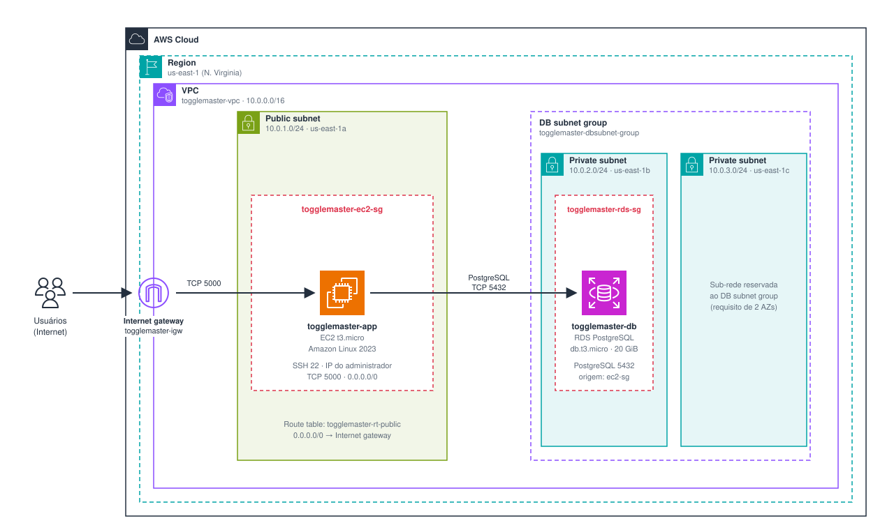

# ToggleMaster – Tech Challenge Fase 1

Documentação da Fase 1: diagrama de arquitetura e discussão sobre o 12-Factor App. O ToggleMaster é uma API de *Feature Flags* (Flask + PostgreSQL) construída como um monolito, executada localmente com Docker e publicada manualmente em uma instância EC2 conectada a um banco RDS na AWS.

## 1. Link para o diagrama de arquitetura

[Abrir e editar o diagrama no diagrams.net](https://app.diagrams.net/#Uhttps%3A%2F%2Fraw.githubusercontent.com%2FJohnLFDS%2Ftogglemaster-tech-challenge-fase1%2Fmain%2Fdocs%2Farquitetura%2Fdiagrama-arquitetura-aws.drawio)

## 2. Discussão sobre o 12-Factor App aplicada ao projeto

Análise feita sobre o código da aplicação (**app.py**, **Dockerfile**, **entrypoint.sh**, **docker-compose.yaml** e **requirements.txt**) e sobre o ambiente implantado na AWS (EC2 + RDS).

### 2.1 Por que a aplicação é um monolito

Um monolito é uma aplicação construída e implantada como **uma única unidade**, na qual todas as responsabilidades compartilham o mesmo código, o mesmo processo e o mesmo banco de dados. O ToggleMaster apresenta essas características:

- **Código concentrado em um único módulo:** o arquivo app.py reúne, juntos, as rotas HTTP (/health e /flags), a validação de entrada, as regras de negócio, o acesso a dados (SQL escrito diretamente com psycopg2) e a criação do schema (init_db). Não há separação em serviços, módulos ou camadas independentes.
- **Uma única unidade de build e deploy:** o Dockerfile gera uma imagem com toda a aplicação e o mesmo comando (gunicorn app:app) a inicia. Na EC2, ela roda como um único processo. Qualquer alteração, por menor que seja, exige reimplantar tudo.
- **Banco de dados único e compartilhado:** todas as operações usam a mesma tabela flags em um único PostgreSQL. Não existem fronteiras de dados entre domínios.
- **Acoplamento de execução e de escala:** criar, consultar, atualizar e remover flags vivem no mesmo processo; não é possível escalar, atualizar ou falhar cada função isoladamente.
- **Stack única e sem comunicação entre serviços:** Python, Flask e Gunicorn, sem filas, APIs internas ou mensageria.

Trata-se de um monolito **pequeno e bem delimitado**: cobre um único domínio (feature flags) e expõe uma API REST simples. Isso o torna adequado como ponto de partida e facilita a futura decomposição em serviços, prevista nas próximas fases do Tech Challenge. Vale registrar que a versão original do código oferece apenas POST, GET e PUT; ao validar o CRUD, o grupo constatou que DELETE /flags/{name} retornava 405 e acrescentou a rota, completando as operações do enunciado.

### 2.2 Vantagens e desvantagens para um MVP

| Aspecto | Vantagem para o MVP | Desvantagem / risco |
|---|---|---|
| Desenvolvimento | Uma base de código, um repositório e um ambiente local (docker compose) bastam para entender e evoluir o sistema. Curva de aprendizado baixa. | Com o crescimento, o arquivo único tende a acumular responsabilidades e dificultar manutenção e testes isolados. |
| Deploy | Um único artefato e um único servidor (EC2). Publicação simples e rápida, ideal para colocar o MVP no ar e receber feedback. | Toda mudança exige redeploy completo; uma falha em qualquer parte afeta a aplicação inteira. |
| Custo | Poucos recursos: 1 EC2 e 1 RDS, cobertos em grande parte pelo Free Tier. | Para suportar mais carga é preciso aumentar a instância inteira (escala vertical), mesmo que só uma rota seja o gargalo. |
| Operação | Poucos componentes para monitorar, depurar e proteger; sem complexidade de rede entre serviços. | Ponto único de falha: a EC2 e o RDS não têm redundância. Logs e métricas ficam locais, sem observabilidade centralizada. |
| Escalabilidade | Suficiente para o volume esperado em um MVP interno. | Não escala por funcionalidade. A escala horizontal exigiria load balancer e múltiplas instâncias, que não existem nesta fase. |
| Evolução | Mudanças de ponta a ponta são simples, sem contratos de API entre serviços. | Quanto mais tempo passa, mais difícil separar o código em serviços; a stack tecnológica fica única. |
| Equipe | Adequado a um time pequeno, que mantém todo o contexto do sistema. | Várias equipes no mesmo código geram conflitos e dependências de release. |

**Conclusão:** para o objetivo da Fase 1 (validar a ideia e publicar rapidamente), o monolito é a escolha correta: menor custo, menor complexidade e entrega mais rápida. Suas limitações de escala, resiliência e autonomia de times são riscos conhecidos e aceitáveis nesta etapa, e serão tratados nas fases seguintes, quando a plataforma evoluir para um sistema distribuído.

### 2.3 Matriz de conformidade com o 12-Factor App

A matriz abaixo avalia cada um dos 12 fatores. **Atende** significa que a prática já está presente no projeto; **Parcial** indica que ela existe, mas precisa de ajustes para um ambiente de produção mais robusto.

| # | Fator | Status | Evidência no projeto | Ajuste recomendado |
|---|---|---|---|---|
| I | Codebase | Atende | Uma única base de código versionada no Git, usada tanto no ambiente local (Docker) quanto na EC2 (git clone). | Manter um repositório por aplicação ao dividir em serviços. |
| II | Dependências | Atende | Dependências declaradas e fixadas em requirements.txt, isoladas por venv na EC2 e por imagem no Docker. O pacote postgresql-client (pg_isready) é instalado explicitamente no Dockerfile. | Atualizar a imagem base (python:3.9-slim) e declarar explicitamente click, que é importado no código mas só chega como dependência transitiva do Flask. |
| III | Configurações | Parcial | O app lê DB_HOST, DB_NAME, DB_USER e DB_PASSWORD de variáveis de ambiente; nenhuma credencial está no código. Porém, o docker-compose.yaml contém usuário e senha fixos, e na EC2 as variáveis ficam em texto claro no ~/.bashrc. O app não valida se as variáveis existem e ignora DB_PORT. | Usar arquivo .env fora do Git (local) e AWS Secrets Manager ou SSM Parameter Store (nuvem); validar a configuração na inicialização e passar a porta ao psycopg2. |
| IV | Serviços de apoio | Atende | O PostgreSQL é tratado como recurso anexado, identificado apenas por DB_HOST: o container “db” local foi trocado pelo RDS sem alterar uma linha de código. | Nenhum para esta fase. |
| V | Build, release, run | Parcial | O Dockerfile separa o build (imagem) da execução, mas o deploy na AWS é manual: git clone, pip install e nohup gunicorn na EC2. Não há versionamento de releases, pipeline nem rollback. | Pipeline de CI/CD que gere uma imagem versionada (build uma vez, executar em qualquer ambiente). |
| VI | Processos | Atende | A aplicação é stateless: não guarda sessão nem estado em memória ou disco; todo estado persiste no PostgreSQL. | Nenhum para esta fase. |
| VII | Vínculo de porta | Atende | A aplicação é autocontida e exporta o serviço pela porta 5000 (gunicorn --bind 0.0.0.0:5000), sem depender de um servidor web externo. | Em produção, publicar atrás de um load balancer com HTTPS. |
| VIII | Concorrência | Parcial | O Gunicorn permite escalar por processos, mas não há --workers configurado (padrão de 1 worker) nem múltiplas instâncias ou load balancer. A conexão com o banco é aberta e fechada a cada requisição, sem pool. | Configurar workers, usar pool de conexões e, mais adiante, escalar horizontalmente (Auto Scaling ou contêineres). |
| IX | Descartabilidade | Parcial | A inicialização é rápida e o entrypoint.sh aguarda o banco (pg_isready) e usa exec, repassando corretamente os sinais ao Gunicorn. Na EC2, porém, o processo roda com nohup, sem supervisão, e não reinicia sozinho após falha ou reboot. | Executar como serviço systemd ou contêiner com política de restart. |
| X | Paridade dev/prod | Parcial | O mesmo código roda nos dois ambientes, mas há diferenças: PostgreSQL 13 no docker-compose contra PostgreSQL 15 informado na estimativa do RDS; o compose usa bind mount do código e publica na porta 5001, enquanto a EC2 usa a 5000. | Alinhar a versão do PostgreSQL e usar a mesma imagem em dev e produção. |
| XI | Logs | Parcial | A aplicação escreve em stdout (print e logs do Gunicorn), como recomendado. Na EC2 a saída é redirecionada para o arquivo gunicorn.log, sem centralização, rotação ou busca. | Enviar os logs para o CloudWatch Logs e adotar logging estruturado. |
| XII | Processos administrativos | Atende | A criação do schema é um comando pontual (flask init-db), executado separadamente e de forma idempotente (CREATE TABLE IF NOT EXISTS), usando o mesmo código e a mesma configuração do app. | Adotar ferramenta de migrations (Alembic ou Flyway) para evolução do schema. |

### 2.4 Resultado e prioridades de ajuste

Dos 12 fatores, **6 estão atendidos** (I, II, IV, VI, VII e XII) e **6 são atendidos parcialmente** (III, V, VIII, IX, X e XI); nenhum está totalmente ausente. Os pontos que atendem refletem o que importa em um MVP: configuração por ambiente, aplicação stateless, banco como serviço externo e porta exposta pelo próprio processo. As lacunas concentram-se em **operação** (deploy, supervisão, logs e segredos), e não no desenho da aplicação.

---

Código da aplicação: <https://github.com/dougls/toggle-master-monolith>
